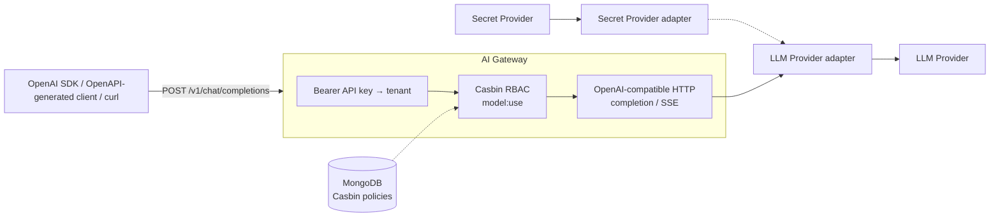

# AI Gateway

   

**An OpenAI-compatible edge that centralizes credentials, per-model authorization, and SSE streaming.**

> **Current stage:** experimental. The HTTP surface and Gemini adapter are implemented; multi-provider routing, semantic caching, PII masking, metrics/traces, and benchmarks are not yet part of the runtime.



## 30-second quickstart

**Prerequisites:** Docker and a Gemini API key. The command below starts MongoDB, applies local policies, and exposes the gateway at `http://localhost:8080`.

```bash
GOOGLE_API_KEY="your-gemini-api-key" docker compose up --build
```

In another terminal, check service health and send a completion using the OpenAI Chat Completions API shape:

```bash
curl --fail-with-body http://localhost:8080/healthz && \
curl --fail-with-body http://localhost:8080/v1/chat/completions \
  -H 'Authorization: Bearer sk_test_123' \
  -H 'Content-Type: application/json' \
  -d '{
    "model": "gemini-3.5-flash-lite",
    "messages": [{"role": "user", "content": "Reply only: gateway online"}],
    "temperature": 0
  }'
```

For SSE-compatible streaming, add `"stream": true` to the payload and use `curl -N`:

```bash
curl -N http://localhost:8080/v1/chat/completions \
  -H 'Authorization: Bearer sk_test_123' \
  -H 'Content-Type: application/json' \
  -d '{
    "model": "gemini-3.5-flash-lite",
    "messages": [{"role": "user", "content": "Count to three."}],
    "stream": true
  }'
```

The `sk_test_123` token and development permissions are local seeds. **Never use them in production.** Swagger is available at `http://localhost:8080/docs` when the process starts with `--debug=true` (as it does in Compose).

## Key features

| Area | Status | Available now |
| --- | --- | --- |
| **OpenAI-compatible contract** | ✅ | `POST /v1/chat/completions` accepts `model`, `messages`, `temperature`, and `stream`; it returns completions or SSE events. |
| **Inference adapter** | ✅ | Google ADK for Gemini; the key is obtained from `GOOGLE_API_KEY`, and every operation has a **120 s** timeout. |
| **Identity and isolation** | ✅ | A Bearer token is associated with a tenant; the raw token is not used as the lookup key. |
| **Model authorization** | ✅ | Casbin authorizes `tenant × object (model) × use`; local policies are stored in MongoDB. |
| **Upstream failures** | ✅ | Cancellation, timeout, configuration, and provider errors are normalized into compatible error responses. |
| **Rate limits and quotas** | 🗺️ Planned | There are no request, token, cost, or concurrency limits per tenant, key, or model. |
| **Dynamic routing / fallbacks** | 🗺️ Planned | The gateway instantiates a single `LLMProvider`; it does not select by cost, latency, region, or automatic fallback. |
| **Semantic caching** | 🗺️ Planned | The chat use case has an extension point, but there is no cache, embeddings, or response storage implemented. |
| **Observability** | 🗺️ Planned | JSON logs, request logging, and exported Prometheus metrics exist; but OpenTelemetry traces are not yet wired into the server. |
| **Guardrails / PII masking** | 🗺️ Planned | The runtime does not mask PII or enforce content policies before sending requests to the provider. |

### Scope boundaries

RAG, agents, and workflows are not goals of this gateway. For those use cases, use a specialized framework and invoke it through the gateway like an OpenAI-compatible model. The gateway should focus on edge identity, authorization, policy enforcement, limits, and observability — not duplicate AI application orchestration.

### Current architecture and limits

- **Stack:** Go 1.26.8, Echo v5, OpenAPI 3 + `oapi-codegen`, Google ADK/GenAI, Casbin, and MongoDB.
- **Concurrency:** the HTTP server uses Go/Echo’s concurrency model; rate limits and quotas by tenant, key, model, or cost remain on the roadmap. The project also has no queue or bulkhead.
- **Resilience:** a 120-second timeout and 10-second graceful shutdown exist. Retry, circuit breaker, and fallback do not yet exist.
- **Security:** the provider key comes from the environment; the completion route requires a Bearer token and model-level Casbin authorization. 
- **Contract:** messages are textual.

## Supported provider matrix

| Provider | Transport / adapter | Chat Completions | SSE streaming | Status |
| --- | --- | ---: | ---: | --- |
| Google Gemini | Google ADK (`GoogleADKAdapter`) | ✅ | ✅ | Implemented |
| OpenAI | — | ❌ | ❌ | Not implemented |
| Ollama | — | ❌ | ❌ | Not implemented |

The endpoint is OpenAI-compatible; this describes the **input/output contract**, not the upstream providers currently available.

## OpenAPI: contract-first, typed clients

[`api/openapi.yaml`](api/openapi.yaml) is the gateway’s **canonical contract**. It defines endpoints, authentication, payloads, responses, and errors. This decouples client integrations from the internal implementation: consumers can generate typed SDKs directly from the same specification used by the server.

### Generate a TypeScript or Python SDK

The commands below use the official OpenAPI Generator image and require only Docker. Run them from the repository root. The `./generated` directory is a local artifact—add it to the consumer project’s `.gitignore` or version it according to your organization’s policy.

```bash
# TypeScript: Fetch-based client for browsers and modern runtimes
docker run --rm -v "$PWD:/local" openapitools/openapi-generator-cli generate \
  -i /local/api/openapi.yaml \
  -g typescript-fetch \
  -o /local/generated/typescript

# Python: typed client installable as a package
docker run --rm -v "$PWD:/local" openapitools/openapi-generator-cli generate \
  -i /local/api/openapi.yaml \
  -g python \
  -o /local/generated/python
```

After generating the TypeScript SDK, install its dependencies and configure the gateway URL and Bearer token according to the API exposed by the generated code. A typical call looks like this:

```typescript
const response = await fetch("http://localhost:8080/v1/chat/completions", {
  method: "POST",
  headers: {
    Authorization: "Bearer sk_test_123",
    "Content-Type": "application/json",
  },
  body: JSON.stringify({
    model: "gemini-3.5-flash-lite",
    messages: [{ role: "user", content: "Explain the OpenAPI contract." }],
  }),
});

const completion = await response.json();
```

> The generator produces class names, methods, and authentication options based on the selected spec and generator versions. Pin the OpenAPI Generator image version in CI for reproducible builds, and regenerate clients whenever the contract changes.

## Advanced configuration

There is no YAML/JSON routing file in the current runtime. Operational configuration uses environment variables, and authorization is implemented as a Casbin policy persisted in MongoDB.

### Environment variables

| Variable | Required | Purpose |
| --- | ---: | --- |
| `GOOGLE_API_KEY` | Yes | Credential passed to the Gemini client through Google ADK. |
| `DATABASE_HOST` | Yes | MongoDB host used by the Casbin adapter. |
| `DATABASE_PORT` | Yes | MongoDB port. |
| `DATABASE_USERNAME` | Yes | MongoDB username. |
| `DATABASE_PASSWORD` | Yes | MongoDB password. |
| `DATABASE_NAME` | Yes | Database containing Casbin rules. |
| `DATABASE_AUTH_SOURCE` | Yes | MongoDB authentication database. |

### Per-model access policy

The local development seed policy below allows `tenant-local-dev` to use only the listed models. This is the current tenant/model consumption-control mechanism; it is not a routing or retry rule.

```javascript
const devPolicies = [
  { ptype: "p", v0: "tenant-local-dev", v1: "gemini-3.5-flash-lite", v2: "use" },
  { ptype: "p", v0: "tenant-local-dev", v1: "gemini-3.1-pro-preview", v2: "use" }
];
```

## Performance benchmarks

There are no versioned benchmarks in this repository. To preserve operational trust, the project does not publish claims such as “`<2 ms` overhead,” memory usage, or throughput without a reproducible methodology.

| Critical metric | Current verifiable value | Operational implication |
| --- | --- | --- |
| Gateway p50/p95 overhead | **Not measured** | Do not assume proxy latency is known until you run load tests in your environment. |
| Idle / loaded RSS memory | **Not measured** | Set resource requests and limits only after profiling the binary and your actual concurrency pattern. |
| Sustained throughput and concurrency | **Not measured** | Validate connection pooling, MongoDB, and provider limits before production. |
| Per-provider-call timeout | **120 s** | Limit applied by the Gemini adapter to normal and streaming calls. |
| Graceful shutdown | **10 s** | The server waits up to 10 seconds for active requests after receiving a shutdown signal. |

### Minimum protocol for publishing numbers

1. Compare a direct Gemini call with the same call through the gateway.
2. Record added p50, p95, and p99 latency, RSS, CPU, error rate, and throughput.
3. Pin the commit version, region, model, prompt/response size, concurrency, and test duration.
4. Publish the script and raw data with the table. Without them, performance numbers are neither comparable nor actionable.

## Contributing

### Local Development

```bash
# Generate server/types from api/openapi.yaml
make generate

# Run all tests
make test

# Generate the contract and build the Docker image
make build

# Start the Docker stack (and rebuild the image when needed)
export GOOGLE_API_KEY="your-gemini-api-key"
make run
```

The canonical API contract lives in [`api/openapi.yaml`](api/openapi.yaml). After changing it, run `make generate` and include the generated changes to `internal/transport/http/gen.go` in the same pull request. See also [OpenAPI: contract-first, typed clients](#openapi-contract-first-typed-clients).


### Add a provider adapter

1. Implement `LLMProvider` in `internal/adapter/<provider>/`, covering `GenerateCompletion` and `StreamCompletion`.
1. Add credential mapping to `SecretProvider`—or provide a secure alternative implementation for your secret manager.
1. Wire the new adapter in `cmd/root.go` without changing HTTP handlers.
1. Add unit tests for request mapping, response mapping, errors, and streaming; run `make test`.
1. Add a **Live Contract / Integration Test** (behind a `//go:build integration` build tag) that executes against the real provider API when the appropriate `API_KEY` is set.
1. Update the Ginkgo E2E test suite in `./e2e/` to verify the provider works through the Gateway's public endpoint(s).
1. Update this provider matrix and the OpenAPI contract whenever the exposed compatibility changes.

## License

**There is no `LICENSE` file in the repository yet.** Until a maintainer adds one, do not assume permission to redistribute, modify, or use this project commercially. An infrastructure contribution should include an explicit license decision before the project is promoted as reusable open source.
